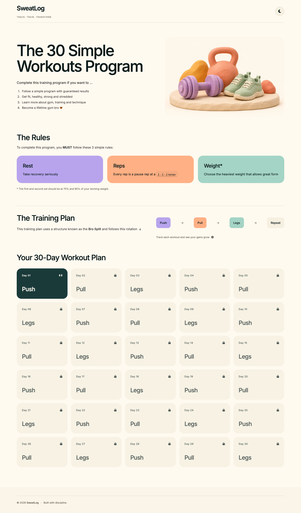
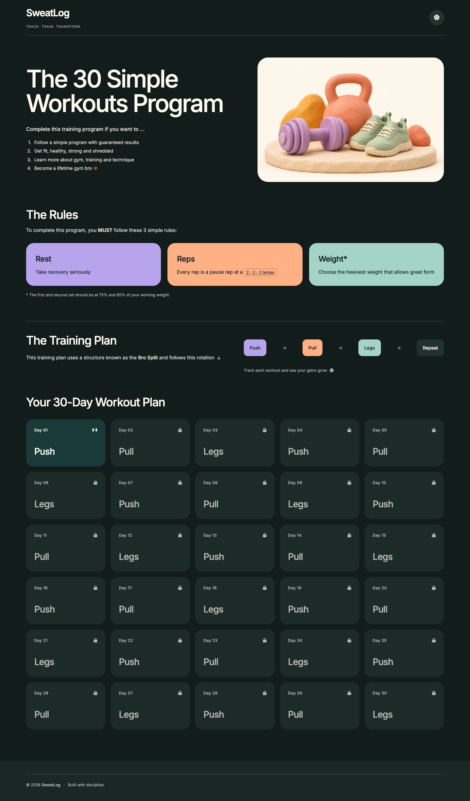

# SweatLog

**Track. Train. Transform.**

SweatLog is a 30-day workout tracker designed to keep your training structured, goal-driven, and brutally effective. It follows the proven Bro Split method and gives you a no-excuses path to building muscle and discipline - one workout at a time.

---

## 🔧 Features

- 30-day structured program (Push → Pull → Legs cycle)
- Visual daily workout tracker with lock/unlock states
- Lightweight UI optimized for focus and clarity
- Fully responsive with light/dark mode toggle
- LocalStorage-backed progress tracking

---

## 🚀 Live Link

[**Launch SweatLog →**](https://sweat-log.vercel.app/)

---

## 🖼️ Screenshots

Full desktop views of the current interface:





---

## 💡 Why I Built This

I built SweatLog to simplify training for beginners and intermediates who want results without overthinking. The aim was to distill all the fluff and focus only on what matters - consistency, progressive overload, and recovery. SweatLog helps you train like a lifter, not a casual.

---

## 🧱 Challenges & Lessons

- Designing a strict, fixed 30-day UI that still feels intuitive and interactive
- Handling visual state changes for day locking/unlocking with clarity
- Balancing minimal design with motivational UX cues
- Implementing local storage without relying on bloated libraries
- Creating a responsive layout that works across all screen sizes

---

## 🧠 What I Learned

- Precision in layout grids pays off - especially in structured, day-by-day UIs
- User clarity comes from constraint, not from flexibility
- You don’t need backend complexity to build something impactful

---

## 🗂️ Tech Stack

- **React** + **TailwindCSS** + **JavaScript**
- **LocalStorage** for persistent state
- **Responsive design** using grid-based layout
- Deployed with **Vercel**

---

## 📦 Future Enhancements
- Authentication (replace local storage) for persistent, cross-device progress saving.
- Visual analytics: volume tracking, streak counters, rep tempo graphs.
- Shareable progress reports or transformation logs.

---

## 📁 Project Setup

Clone the repo and run locally:

```bash
git clone https://github.com/the-ajay-panigrahi/sweatlog
cd sweatlog
npm install
npm run dev
```

---

> “Discipline is remembering what you want.” — David Campbell

